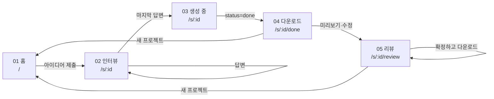

# 화면 흐름

- 02·03 은 **같은 URL, 같은 레이아웃**. 하단 입력 영역만 "답변 도크" ↔ "생성 진행 표시"로 바뀐다.
- 새로고침해도 이어져야 한다: 모든 화면은 URL 의 `:id` 로 `GET /api/sessions/:id` 를 불러 상태를 복원한다.
  (LangGraph 체크포인트가 세션을 들고 있으므로 프론트는 상태를 따로 저장하지 않는다)

## 전환 표

| # | 출발 → 도착 | 트리거 | API | 넘기는 데이터 | 전환 연출 |
|---|---|---|---|---|---|
| T1 | 홈 → 인터뷰 | "설계 시작" 클릭 / 입력창 Enter (한글 조합 중 Enter 무시) | `POST /api/sessions` | `session_id` → URL, 첫 질문 | 홈 콘텐츠 위로 빠짐 → 인터뷰 패널 아래에서 올라옴, 상단 단계 표시 01→02 |
| T2 | 인터뷰 → 인터뷰 | 선택지 클릭 / 직접 입력 전송 | `POST /api/sessions/:id/answers` | 답변 텍스트 | 내 말풍선 pop → 타이핑 점 3개 → 다음 질문 pop, 진행 바 증가 |
| T3 | 인터뷰 → 생성 중 | 응답이 `status: "generating"` | 같은 응답 | 없음 | 답변 도크 → 스피너+현재 파일명, 파일 목록 위로 스캔 라인, 단계 02→03 |
| T4 | 생성 중 → 다운로드 | 폴링/SSE 로 `status: "done"` | `GET /api/sessions/:id` | 파일 목록 | 파일 행이 하나씩 "완료"로 번쩍, 마지막 완료 0.9초 후 이동 |
| T5 | 다운로드 → 리뷰 | "미리보기·수정" 클릭 | `GET /api/sessions/:id/artifacts` | 파일 내용 전체 | 리뷰 3단 레이아웃 stagger 등장 |
| T6 | 리뷰 내부 | 수정 요청 전송 / 칩 클릭 | `POST /api/sessions/:id/revisions` | 파일, 선택 줄(선택), 요청 문장 | 해당 파일 탭으로 이동, `+`/`−` diff 줄 강조, 제안 바 등장 |
| T7 | 리뷰 내부 | 적용 / 되돌리기 | `POST …/revisions/:rid/accept` 또는 `/reject` | — | 버전 v{n} 증가, 탭에 변경 점 |
| T8 | 다운로드·리뷰 → 파일 | 다운로드 버튼 | `GET /api/sessions/:id/download` (zip) | — | 하단 토스트 + 진행 막대 |
| T9 | 어디서든 → 홈 | 로고 / "새 프로젝트" | 없음 | 상태 초기화 | — |

## 오류 · 예외

- API 실패: 화면을 바꾸지 않고 해당 영역 안에 다시 시도 버튼. 홈으로 튕기지 않는다.
- 생성이 오래 걸림(> 60초): "아직 만드는 중" 문구와 함께 계속 대기. 취소 버튼은 [미확인] — 백엔드 취소 지원 여부.
- 존재하지 않는 `:id`: 홈으로 보내고 토스트 "세션을 찾을 수 없어요".
- 리뷰에서 제안이 떠 있는 채로 다른 요청: 기존 제안은 버리고 새 제안을 띄운다 (시안 동작).
